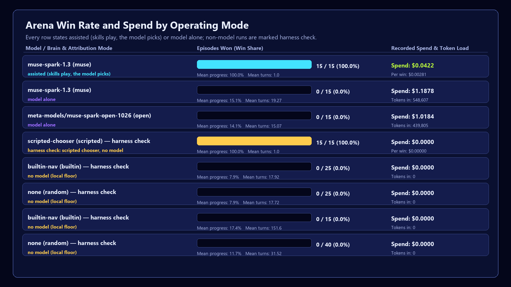
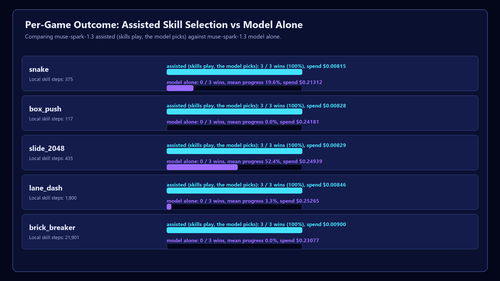
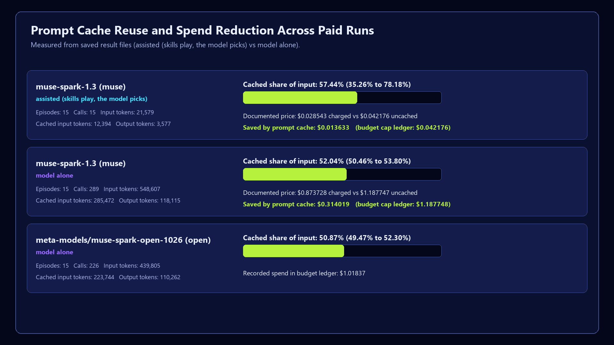

# playfellow-coop

**Built on the PlayFellow engine (hesham88/playfellow). Two tags say what existed when: before-kickoff = b7b72a8 (committed 08:04, pushed 12:01 on 26 Oct, before the kickoff); pre-hackathon = d63c1b4 (pushed 19:33 on 26 Oct), re-exporting engine work finished before the kickoff in our private repo (LM Studio adapter, memory check, proxy/CA hardening, redaction, game clock), plus packaging. Everything in this repo was built during the event.**

PlayFellow is an open-source engine that plays a PC game *with* you: it watches one game window, asks a brain what to do next, and presses only the keys that game's controls card allows. This repo adds the event work as a plugin package. It does not contain the engine; it installs it. "Coop" here means human-AI co-play: you and the buddy share one game, and you can take the controls back at any moment. The interface is **game-agnostic** (any window, pixels in, keys out); it is not "plays any game" — perception and skills are still fitted per game or work in 2D only.

## The accessibility promise, and its evidence

This is a co-op for adults whose hands can't keep up: one-handed play, tremor, RSI, fatigue. You play; when a part is too hard you say what you want — "grab the coins on the left", "get me past this jump", "take me to the door" — in English or Arabic, by voice or by typing. The buddy does that one part, with the same keys you would press, only in the game window you chose, and then the controls come back to you by themselves. Split controls ("you block, I heal") keep the keys you kept out of the buddy's hands entirely. **F9** hands the controls over and back; **F12** and the mouse in the top-left corner stop everything at once.


```
python -m playfellow_coop --assist --typed            # you start with the controls; type what you want done
python -m playfellow_coop --assist --keep j,k --typed # split controls: j and k stay yours
```


**What each part adds** (same 5 games, drawn from `results/fifteen/*.json` by `tools/make_charts.py`): a Meta model alone wins 0 of 10
games; with SAM 3.1 marks it makes more progress; with the local skills it picks, the same models win **15 of 15** (Muse Spark Open) and
**13 of 15** (Muse Spark; the other 2 ended on a service error), for about **4 cents** a run. Every number is labelled *model alone* or
*assisted*.

**The co-op itself, measured:** the assist did 65 of 66 asked-for parts on 5 games and 20 of 20 on the open-source 2048 (MIT, played from
pixels); with split controls 0 kept-key presses ever reached a game. With a model choosing every key, live, the application's own requests
were done 4 times in 10, and every "done" it said was true (3 of 3). SAM 3.1 kept the same number on the same thing in 129 of 129 frame
pairs. Muse Wonder learned the controls of games it had never seen (genre 3/3, keys found 0.68) and wrote 10 of 10 debriefs with no
invented number. Each promise of our application, with its code, tests and file: **[docs/accessibility-proof.md](docs/accessibility-proof.md)**.
No disabled player has used this build yet; that is the next step, not a result.


No disabled player has tested this build. We say that plainly instead of claiming a study that never happened. What stands behind the promise is measured, and every number below names its file:

- **Breaches.** Every run counts a breach — a key outside the game's card, or input while another window was in front. In every result file in this repo the breach count is **0**, because the engine checks each reply against the card before the hands move, and presses nothing while the game is not in front.
- **Parts done, presses spared.** The offline assist bench scores parts against the games' own progress (`done_by: game_progress`): parts done, presses the player did not have to make, zero breaches. Its result file lands in `results/access/` when the assist merge lands.
- **What "done" means.** Live, the planner says a part is finished (`done_by: model_said`) or the screen-goal check says so (`done_by: screen_goal`, built on the strict goal-number pairing in `playfellow_coop/universal/state.py`). The record always names which; the model's word is never reported as a measured fact. Offline with the built-in brain, a part ends at its turn limit and says so: "I couldn't finish …".

## What was measured

**Assisted** means local skills play and the model picks which one; **model alone** means the model had no skill to start. The gap between the two rows is the honest headline.

| Row | Result | File |
|---|---|---|
| Assisted: Muse Spark 1.3 picks a skill | **15 of 15 = 5 games (snake, box_push, slide_2048, lane_dash, brick_breaker) x 3 seeds**, $0.04075, 21,579 tokens in (13,787 cached) | `results/k-lane/muse-skills-pt1.json` |
| One-call probe | 1 of 1, $0.00282 | `results/k-lane/muse-probe.json` |
| Assisted: Muse Spark Open on Baseten picks a skill | **14 of 15 assisted**, $0.03576 | `results/k-lane/baseten-skills.json` |
| Model alone: Muse Spark 1.3, raw pixels, no skill | **0 of 15 wins**, mean progress 0.151, $1.18775 | `results/unseen/muse-raw-20261027.json` |
| Model alone: open weights, raw pixels | **0 of 15 wins**, mean progress 0.141, $1.01837 | `results/unseen/open-raw-20261027.json` |

One file is not a result and says so inside itself: `results/k-lane/muse-skills-pt1-billing-failed.json` ("void": billing failed, no call reached the model). A test keeps any paid row with episodes but zero tokens from standing without that mark, so no chart can read a billing failure as a score.







## The ladder

Each game group shows the same rungs. A row is filled only from a committed result file named in it; a rung with no file says so. Assisted rows are never read as model-alone rows.

The five games with human-written skills (snake, box_push, slide_2048, lane_dash, brick_breaker), 3 seeds each unless said:

| Rung | Wins | Mean progress | File |
|---|---|---|---|
| 0 Local floor (random, 8 seeds a game) | 0 of 40 | 0.117 | `results/unseen/random-20261027.json` |
| 0 Local floor (built-in, no model) | 0 of 15 | 0.174 | `results/unseen/builtin-free-20261027.json` |
| 1–2 Model alone, Muse Spark 1.3 (20-call cap; a win needs 39–5,994 steps) | 0 of 15 | 0.151 | `results/unseen/muse-raw-20261027.json` |
| 1–2 Model alone, Muse Spark Open (same cap) | 0 of 15 | 0.141 | `results/unseen/open-raw-20261027.json` |
| 2+ Model alone, fair budget + action chunks (F2) | pending: run after the owner's yes | — | no file yet |
| 2+ Model + SAM 3.1 marks at the same cap | not in this repo's arena files | — | no arena file here |
| 3 Model-written skills (SkillSmith, F1) | pending: run after the owner's yes | — | harness `bench/skillsmith_run.py`; offline fake round only |
| 4 Model picks + human skill, Muse Spark 1.3 | 15 of 15 | 1.0 | `results/k-lane/muse-skills-pt1.json` |
| 4 Model picks + human skill, Muse Spark Open | 14 of 15 (snake 2 of 3) | 0.933 | `results/k-lane/baseten-skills.json` |

The SkillSmith games (no human skill exists for them):

| Game | Rung 3 state | File |
|---|---|---|
| maze_chase | pending: run after the owner's yes | no file yet |
| key_caves | pending: run after the owner's yes | no file yet |
| action_quest | the gym has no progress score for it yet, so it cannot be scored | no file yet |

Speed and cost per rung (stage times, dollars and tokens per win, cache share, local step against a model call) are in `results/speed/speed-cost-20261102.json`, built only from the files above by `bench/speed_cost_table.py`. The Rust fast path's public figure is 17–24x, the bracket of the measured medians in that table's source file.

## The three Meta models, and Baseten

- **Muse Spark** (`muse-spark-1.3`, `playfellow_coop/muse_brain.py`) reads the marked frame, your words and the controls card, and answers with a plan and keys as JSON. Pinned address, no proxy or CA variables, redirects refused, contributor models refused in code, the key never shown. A daily budget cap (`playfellow_coop/budget.py`) stops a call **before** it is sent.
- **SAM 3.1** (`playfellow_coop/sam_marks.py`, `sam_eval.py`) turns the screen into numbered marks the brain can point at, asked again only when the picture changes and gated by the same budget. The protocol reading is strict; offline it is checked against a fake server built from the arena's own truth and against Meta's shared conformance cases. Fake-server scores check the harness only and say nothing about SAM's accuracy; the table above never mixes the two.
- **Muse Voice Transcribe** (`playfellow_coop/voice.py`, `realtime_voice.py`, `push_to_talk.py`, `microphone.py`): hold a key, speak, release — English and Arabic, partial text live, the final words become a command. Typed commands are the always-available fallback, so no demo needs a microphone. The realtime socket refuses redirects so the key is never sent onward.
- **Baseten** serves Muse Spark Open for the open-weights bench row only. It is not a runtime brain: nothing public or judge-facing is routed there, and a test keeps it that way.

Any agent can ask for one part under the same rules through the MCP server (`docs/mcp.md`): `python -m playfellow_coop.mcp_server`.

## Judges: try it

**Judges:** see the access note in the submission. [JUDGES.md](JUDGES.md) has the three paths — replay with no key, offline live on the Practice Arena with the built-in brain, live with your own keys — and how to test it yourself on a game. Every command there has been run and its output pasted in.

## Limits, said plainly

- No disabled player has tested this build, and no player study is claimed.
- Perception and skills are fitted per game or work in 2D only; a new game is learned, not assumed.
- The open code is a single-rate loop. Nothing here claims a multi-rate, 60 Hz or three-speed loop, an inverse-dynamics model, or a level above L0 on the Practice Arena.
- Split controls are built and offline-tested on the architect's branch; this README calls them shipped only when that merge lands here.
- The hand-over, typed commands and marks are tested offline with pretend eyes, hands and brain; live runs are the dated result files above, nothing more.

## What is in this repo

| Piece | What it does | Status |
|---|---|---|
| `playfellow_coop/muse_brain.py`, `budget.py` | The Muse brain and its daily spending cap | built; live rows above |
| `playfellow_coop/handover.py`, `session.py` | You take over, I take over (F9), with a hand-back line made only of counted facts; the turn loop around the engine's public building blocks | built; tested with pretend eyes, hands and brain |
| `playfellow_coop/sam_marks.py`, `sam_eval.py`, `sam_protocol.py` | SAM 3.1 marks and their strict reading | built; fake-server and conformance-tested offline |
| `playfellow_coop/voice.py`, `realtime_voice.py`, `push_to_talk.py`, `microphone.py` | Voice or typed commands, EN/AR | built; fake-socket tested; no real voice call yet |
| `playfellow_coop/mcp_server.py` | The MCP server: any agent asks for one part under the player's rules | built; tested with a fake brain, no network (`docs/mcp.md`) |
| `playfellow_coop/universal/` | The goal checker (strict number-noun pairing), the guardrails, the screen-state reader, the game clock and supervisor | built; synthetic-input tests |
| `playfellow_coop/adk_app/` | Google ADK agents and ADK's own evaluator on our exported evalset, in ADK's own pinned environment | built; a missing engine is a setup failure there, never a lost game |
| `playfellow_coop/stage_timer.py`, `bench/` | Per-stage timing that writes "not measured" instead of inventing a number | built; offline-tested |
| `rust/fastpath`, `playfellow_coop/fastpath.py` | An optional Rust fast path with an identical Python twin | built during the event; see `rust/README.md` |

## Install and run

Python 3.11 or newer. Put the engine and this repository **side by side in one folder** (the tests look for the engine next to this repository, or at the folder named in `PLAYFELLOW_ENGINE`), and use one virtual environment for both:

```
python -m venv .venv
.venv\Scripts\activate
git clone --branch pre-hackathon https://github.com/hesham88/playfellow.git
pip install -e playfellow
cd <this repository's folder>
pip install -e .
pip install pytest setuptools
```

The engine's controls cards and settings files sit next to its code, so the engine is installed editable (`-e`), from a clone of the tag. `pytest` is not installed by the package, and `setuptools` is needed by one install test on Python 3.12 and newer.

## How to run the demo (no microphone needed)

1. Install as above, then open the Practice Arena from the engine: `python -m practice_arena.arena` (in the engine's `software` folder).
2. In this repo, start the buddy with the built-in brain, which needs no key and no network, and with typed commands:

   ```
   python -m playfellow_coop --typed
   ```

   With a Muse key in `MODEL_API_KEY`, add `--brain muse` (SAM marks are then on by default; `--marks off` turns them off). To talk instead of typing, add `--talk-key f8` and hold F8 while you speak.
3. Click the arena window so it is in front: the buddy presses keys only while the game is in front.
4. **You take over, I take over.** Press **F9**: the buddy lets go of every key and waits, asking no AI. Play yourself. Press **F9** again: the buddy takes the controls back and says in one line how long you played and how many turns it waited out.
5. Type a command in the terminal, for example `grab the coins on the left`, and press Enter. It goes to the planner on the buddy's next turn.
6. **F12**, or the mouse in the top-left corner, stops everything at once.

```
python -m playfellow_coop --brain muse --marks sam  # F9 takes the controls, F9 again gives them back, F12 stops
python -m playfellow_coop --brain local-open --model <id>  # an open model on this PC through LM Studio (the engine's memory check runs first)
python -m playfellow_coop --overlay                # the in-game widget: a slim bar at the top centre with the mic (see below)
python -m playfellow_coop                           # the same with the engine's built-in brain (no key, no network)
```

### Any game, full screen or not

Start the game first, then PlayFellow, naming the game's window. With no controls card for that game, `any_game` is the general one, and `--brief` has the planner write down what it knows of the game first (only keys on the card survive).

```
python -m playfellow_coop --window "<game window title>" --card any_game --brain muse --overlay --assist 4 --brief --input scancode
```

- **The widget.** A slim bar docked at the top centre of the screen, over the game. It starts folded and see-through (opacity 0.55). The arrow slides the panel down and back up with an eased animation, and the opacity slider stops at 0.3, so the widget never vanishes. The mic is on the bar itself: hold it, speak, release. Your words go to the buddy in any game, not only one.
- **Full screen.** The widget is a no-focus, always-on-top window that re-asserts "on top" every 300 ms. It never takes the game's focus. The owner checked that method over a full-screen commercial game on Windows 11. The widget's own live check is listed in `docs/owner-live-checks.md`.
- **Keys.** `--input scancode` sends hardware scan codes, which games that read raw input (most full-screen games) accept. Every card key has one.
- **Hand-back.** After `--assist N` turns, or when the buddy and a second look agree the part is done, the controls come back to you by themselves. Saying "wait" or "I've got it" hands them back at once; "stop" (or F12) stops everything.

## Tests

```
python -m pytest -q
```

Every test runs offline: a fake server on 127.0.0.1 stands in for the Meta API, and nothing presses a key, grabs the screen or spends money. Without the optional Rust DLL (see `rust/README.md`), the tests that compare it with its Python twin are skipped, not failed. The realtime voice socket refuses a redirect on websockets 16.1.1 and 17.3, the two versions it is tested on, so `pyproject.toml` allows only `websockets>=16,<18`.

## What this does and does not do

It plays and talks with you. It does not judge or score the player. The demo uses our own Practice Arena, the arena pack and one open-source game. Offline, single-player games only (`RESPONSIBLE_USE.md`).

## Contributing

This is an open project, and the maintainer reviews every contribution in depth: [CONTRIBUTING.md](CONTRIBUTING.md) says how, [SECURITY.md](SECURITY.md) says how to report a vulnerability privately, and [CODE_OF_CONDUCT.md](CODE_OF_CONDUCT.md) says how we treat each other. Because the hackathon requires that the submission was made during the event by approved participants, **no outside change is merged before the judging ends on 9 November 2026**; issues and pull requests are welcome to open and discuss before then. The open research behind this work, and what is done and not done, is in [docs/research-roadmap.md](docs/research-roadmap.md); what the application said, corrected against this code, is in [docs/what-the-application-said.md](docs/what-the-application-said.md); the three-part design (open model, open framework, private platform), the loop, the equations and the checks for every piece are in [docs/gegaa.md](docs/gegaa.md).

## Credits and licence

Built by Hesham Aboul-Fetouh ([@hesham88](https://github.com/hesham88)) with AI coding assistance, including Meta's Muse Code. Licence: the `LICENSE` file here is the engine's OpenRAIL-S licence with its no-war attachment, copied verbatim. Meta, Muse and SAM are Meta's names, used here as plain text; this project is not affiliated with or endorsed by Meta. The research, tools and software we use, with their licences, are listed in `NOTICE.md`.
