**Built on the PlayFellow engine (hesham88/playfellow). Two tags say what existed when: before-kickoff = b7b72a8 (committed 08:04, pushed 12:01 on 26 Oct, before the kickoff); pre-hackathon = d63c1b4 (pushed 19:33 on 26 Oct), re-exporting engine work finished before the kickoff in our private repo (LM Studio adapter, memory check, proxy/CA hardening, redaction, game clock), plus packaging. Everything in this repo was built during the event.**

<p align="center">
  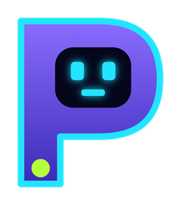
</p>

<p align="center">
  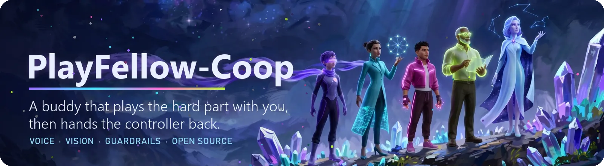
</p>

<p align="center">
  <a href="https://playfellow.rivel.pro"><b>playfellow.rivel.pro</b></a> &nbsp;·&nbsp;
  <a href="https://rivel.pro">Rivel Labs</a> &nbsp;·&nbsp;
  <a href="JUDGES.md">Judges: start here</a> &nbsp;·&nbsp;
  <a href="docs/metrics.md">Every number</a> &nbsp;·&nbsp;
  <a href="docs/research-roadmap.md">Research</a>
</p>

# PlayFellow co-op

**An AI buddy that plays the hard part of a PC game with you, then hands the controls back.** It is built for adult gamers whose
hands can't keep up with what a game demands: one-handed play, tremor, RSI, fatigue. You play. When a part is too hard, you say what
you want, in English or Arabic, by voice or by typing: *"grab the coins on the left"*, *"get me past this jump"*. The buddy does that
part with the same keys you would press, only in the game window you chose, and the controls come back to you by themselves.

- **What it is:** a co-op layer for any Windows game window, with its source published under OpenRAIL-S: pixels in, keys out, and
  every key checked against the game's *controls card* (the list of keys the buddy may press in that game) before it is pressed.
- **How it works:** Meta's **Muse Spark** plans, **SAM 3.1** turns the screen into numbered marks, **Muse Voice Transcribe** hears
  you, and fast local skills do the precise playing.
- **What we measured:** with no skill, Muse Spark 1.3 won **0 of 28** games on 14 games. On the 5 games that have a local skill,
  the models that pick the skill won **15 of 15** and 14 of 15 (Muse Spark Open), 13 of 15 and 15 of 15 (Muse Spark 1.3), for about
  a quarter of a cent a win with the open-weights model. **0 breaches** in every run that counts them.
- **Try it:** with nothing to install, play the [browser arena](https://hesham88.github.io/playfellow-coop/) (the controls, F9
  and F12) or [open the code in Codespaces](https://codespaces.new/hesham88/playfellow-coop) to run the tests and replays; on Windows, one line installs everything, `.\playfellow doctor` checks the rest, and the built-in brain plays with no
  key and no network. Judges: [JUDGES.md](JUDGES.md).

<p align="center">
  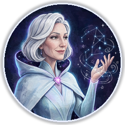
  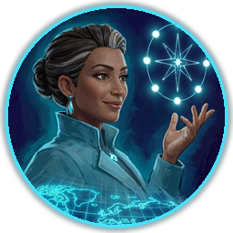
  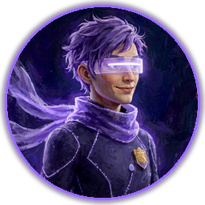
  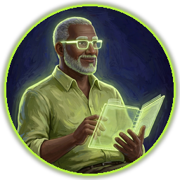
  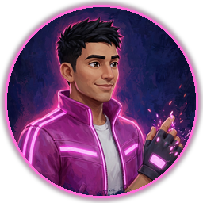
</p>
<p align="center"><sub>The crew is the system: <b>Vela</b> hears, <b>Dalil</b> sees, <b>Fello</b> plans, <b>Hakim</b> guards the keys, <b>Rami</b> plays the precise part.</sub></p>

<table>
<tr><td>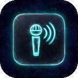</td><td><b>Say it</b>: English or Arabic. Hold F8 and speak, or type a line.</td></tr>
<tr><td>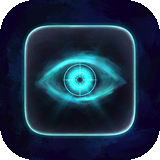</td><td><b>It sees</b>: SAM 3.1 turns the screen into numbered marks the planner can point at.</td></tr>
<tr><td>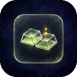</td><td><b>It plays the part</b>: a local skill does the precise work, at the game's speed.</td></tr>
<tr><td>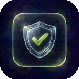</td><td><b>Only your keys</b>: the controls card decides; 0 breaches in every run that counts them.</td></tr>
<tr><td>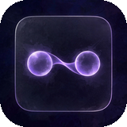</td><td><b>Hand-back</b>: F9 hands over and back; F12 stops everything at once.</td></tr>
<tr><td>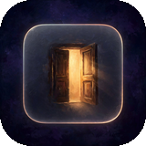</td><td><b>Open</b>: open code, open models, and a built-in brain that needs no key at all.</td></tr>
</table>

<p align="center"></p>

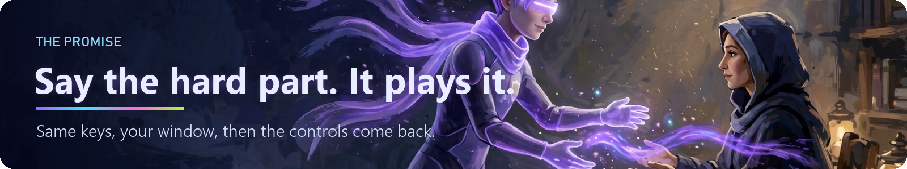

## A session, from the player's side

*An illustration of how the controls fit together (the measured results are further down):* picture Layla, who plays a fast
platformer one-handed. She explores the levels herself, at her own pace. At the boss, the timing asks for
two hands at once. She holds **F8** and says *"dodge his attacks"*. The buddy takes the movement keys and dodges; Layla keeps the
attack keys, because she started PlayFellow with split controls (`--keep j,k`), and the buddy can never press them. When the
storm of fireballs ends, she presses **F9** and has the whole controller back. The game never paused. If anything ever feels
wrong, **F12** (or the mouse in the top-left corner) stops every key at once.

That is why the engineering below exists: the widget never takes the game's focus, every key is checked against the card before
it moves, a "done" counts only after a second look at the screen, and F12 overrides everything.

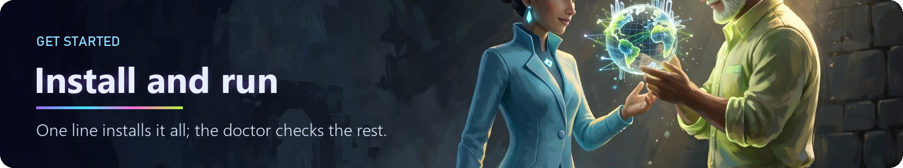

## Install

Windows 10 or 11, Python 3.11 or newer, and Git. One line in PowerShell:

```powershell
irm https://raw.githubusercontent.com/hesham88/playfellow-coop/main/install.ps1 | iex
```

It clones this repository into `%USERPROFILE%\PlayFellow\playfellow-coop` (set `$env:PLAYFELLOW_DIR` to choose another folder),
creates a virtual environment, clones the PlayFellow engine at its pinned tag `pre-hackathon` beside it, installs both (with the
in-game widget and the game packs), and runs the doctor. It changes no machine-wide setting: the bootstrap runs with a process-only
execution-policy bypass. Already cloned? In the repository folder:
`powershell -ExecutionPolicy Bypass -File .\bootstrap.ps1`.

From then on, in the repository folder, **`.\playfellow`** runs everything with the right Python, with no activation step:

```
.\playfellow doctor          # checks Python, Windows, the engine, packages, the widget, your key and open games
.\playfellow doctor --fix    # installs anything missing (it shows the plan and asks first)
```

The doctor sends nothing and calls no model. On Linux or macOS, for the offline tests and the key-free replays (playing a game
needs Windows): `curl -fsSL https://raw.githubusercontent.com/hesham88/playfellow-coop/main/install.sh | sh`, then `./playfellow doctor`.

<details>
<summary>Manual install (the same steps by hand)</summary>

Put the engine and this repository side by side in one folder, with one virtual environment for both:

```
python -m venv .venv
.venv\Scripts\activate
git clone --branch pre-hackathon https://github.com/hesham88/playfellow.git
pip install -e playfellow
git clone https://github.com/hesham88/playfellow-coop.git
cd playfellow-coop
pip install -e .[all] pytest setuptools
python -m playfellow_coop doctor
```

The engine is installed editable (`-e`) from a clone of its tag, because its controls cards and settings sit beside its code.
The tests find it beside this repository, or at the engine's `software` folder named in `PLAYFELLOW_ENGINE`. With the virtual
environment active, `python -m playfellow_coop` is the same as `.\playfellow`.
</details>

**Your Meta key (optional).** The built-in brain needs none. For Muse Spark, SAM 3.1 and voice, get a Meta Model API key at
[dev.meta.ai](https://dev.meta.ai), then:

```
.\playfellow keys set       # hidden input; stored in the Windows credential manager
.\playfellow keys status    # says whether a key is set and where from; never shows it
.\playfellow keys remove
```

The key is read only from the `MODEL_API_KEY` environment variable or the Windows credential manager, is never printed or logged,
and is sent only to the pinned Meta API address, with proxies and redirects refused.

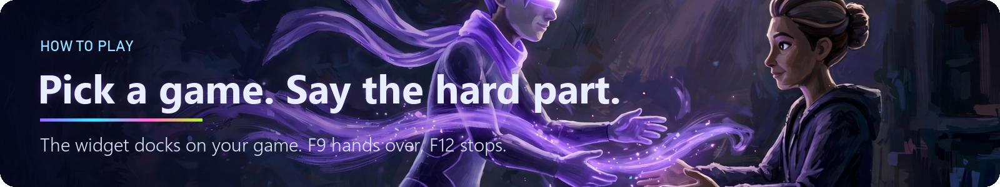

## How to play

**1. Start your game first**, windowed or full screen.

**2. Let PlayFellow find it:**

```
.\playfellow games
```

It lists the open windows PlayFellow may play (launchers, browsers, chat, mail, system tools and payment pages are never played)
and prints the exact start command for each, with the matching controls card when the engine has one, or the general
`any_game` card.

**3. Start the buddy on that game** (copy the line `games` printed; this is its shape):

```
.\playfellow --window "<game window title>" --card any_game --overlay --assist --typed --talk-key f8
```

**4. Click the game** so it is in front: the buddy presses keys only while the chosen game is in front, and waits otherwise.

- **The widget docks itself to the top centre of the game you chose** and follows that window when it moves or resizes. It
  starts folded and see-through, never takes the game's focus (it re-asserts "on top" every 300 ms without activating), and
  carries the mic, the buddy's last lines and every key it answers to.
- **Talk:** hold **F8** (`--talk-key f8`; or the mic on the widget), speak, release. Voice needs a Meta key.
- **Type:** press **Ctrl+Alt+P** to open the widget's panel, type, press Enter; the panel gives the game the front back. Or type in
  the terminal (`--typed`) and click the game again: the command waits for the buddy's next turn.
- **Hand over:** **F9** gives you the controls (the buddy lets go of every key and asks no AI); **F9** again gives them back.
- **Stop:** **F12**, or the mouse in the top-left corner, stops everything at once. Saying "stop" does the same.
- **The part ends by itself:** after its turns (`--assist` alone gives 12; `--assist 6` gives 6), or when the planner says it is
  done *and* a second look at the screen agrees. "Wait" or "I've got it" hands the controls back at once.
- **Split controls:** `--keep j,k` keeps those keys yours; the buddy can never press them.
- **Full-screen games:** add `--input scancode` (hardware scan codes, which games reading raw input accept). The widget keys are
  **Ctrl+Alt+P** (open or fold) and **Ctrl+Alt+O** (see-through, four steps, never invisible); `--summon-key` and
  `--see-through-key` change them, and a key the game's card uses is refused.

**With a model:** add `--brain muse` (SAM marks come on with it; `--marks off` turns them off), and `--brief` to have the planner
first write down what it knows of the game. **No key at all:** leave `--brain` out and the engine's built-in brain plays.

**Try it with no game installed**, on our Practice Arena. In a second PowerShell window, from the repository folder:

```
cd ..\playfellow\software; ..\..\playfellow-coop\.venv\Scripts\python -m practice_arena.arena
```

Then in the first window: `.\playfellow --assist 6 --typed`, click the arena, and type `grab the coins on the left`. With no key,
the built-in brain plays the part and never declares it done, so the part ends at its 6 turns and the controls come back with a
line of counted facts.

### Commands

| Command | What it does |
|---|---|
| `.\playfellow doctor [--fix] [--yes]` | Checks this PC; `--fix` installs what is missing after showing the plan |
| `.\playfellow games` | Lists the open games PlayFellow may play, each with its start command |
| `.\playfellow keys set \| status \| remove` | The Meta key in the Windows credential manager; never shown |
| `.\playfellow models` | The brains and model ids, with the measured cost of each from the result files |
| `.\playfellow stk [widget] [args]` | The SuperTuxKart pack (below) |
| `.\playfellow mcp --game "<title>"` | The widget MCP server: **Meta's Muse Code or any MCP agent** drives the widget on a real game (`docs/mcp.md`) |
| `.\playfellow --window ... --card ... [--brain builtin\|muse\|local-open] [--model ID]` | Play with the buddy |
| `python -m playfellow_coop.mcp_server` | The part server: an agent asks for one part of an arena game under the same rules |

Every play flag is listed by `.\playfellow --help`: limits (`--max-steps`, `--max-seconds`, `--max-usd`, `--daily-usd`), the
session log and trace files, `--dry-run`, and more.

**Drive it from Meta's Muse Code.** Add PlayFellow to your agent's MCP settings and talk to it: *"open the PlayFellow widget, make it 70%
see-through, and tell the buddy to grab the gift boxes"*. Give `mcp --game` the same title as `--window`: it is the one widget,
however it was started. The agent gets the player's powers and no more: its words reach the game
only as a command, only the card's keys are pressed, and F9 and F12 still win. The settings block is in [docs/mcp.md](docs/mcp.md).

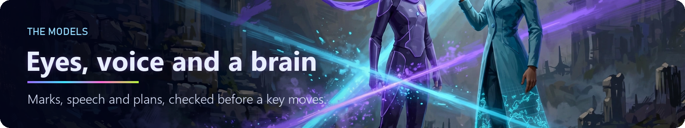

## What it is built from

- **Muse Spark** (`muse-spark-1.3`) reads the marked frame, your words and the controls card, and answers with a plan and keys as
  JSON held to a schema whose actions are exactly the card's keys. Pinned address, no proxy or CA variables, redirects refused,
  contributor models refused in code, and a daily budget that stops a call **before** it is sent.
- **SAM 3.1** turns the screen into numbered marks, asked again only when the picture changes, with a local tracker in between.
  It kept the same number on the same object in **129 of 129** frame pairs.
- **Muse Voice Transcribe** streams push-to-talk speech in English and Arabic, partial text live; the final words become a command.
  Measured on 20 clips of one adult speaker: **15 of 20** commands right (English 7 of 7, Egyptian Arabic 5 of 7, mixed 3 of 6).
- **Muse Wonder** drafts a controls card for a game it has never seen (genre right in 3 of 3, 68% of the real keys found) and words
  the after-session debrief from counted facts only (10 of 10 with no invented number).
- **Local skills** do the precise playing at the game's own speed: 14 pixel skills for the arena games, a 2048 look-ahead, the
  SuperTuxKart driver and the Endless Sky pilot. A model picks the skill; the skill plays.
- **SkillSmith** lets the model write a new skill during a run. Each candidate runs in a separate low-integrity Python process with
  a hard time limit per step, and is promoted only if it beats the current skill on held-out seeds.
- **An optional Rust fast path** with an identical Python twin: **17–24x** faster on the measured stages.

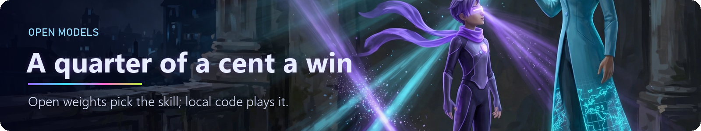

## Open models: the cost-effective path

The design puts the expensive part, precise timing, in local code, and asks the model only to choose. That is what makes open
models practical here:

| Brain | Result on the 5 skill games | Cost |
|---|---|---|
| **Muse Spark Open** (open weights, served on Baseten) picks a pre-written skill | **15 of 15** | **$0.0025 a win** ($0.038 for all 15) |
| Muse Spark 1.3 picks a pre-written skill | 13 of 15 | $0.0027 a win |
| Muse Spark 1.3 alone, raw pixels, 14 games | 0 of 28 | $1.55 for the run |
| **Any open model on your own PC** (`--brain local-open --model <id>`, through LM Studio) | runs offline | **$0**, no key, no network |

The open-weights figures use Muse Spark's Standard price as an upper bound until Baseten publishes its own price for this model.
`--brain local-open` runs the engine's memory check first and refuses a model that will not fit, so a laptop is never frozen.
`python -m playfellow_coop models` prints this table from the result files on your machine.

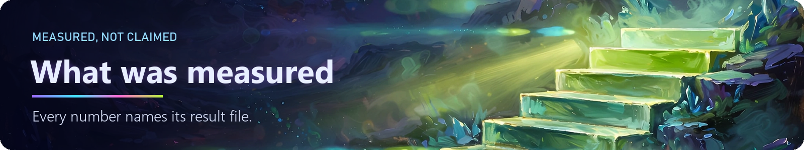

## Results

**Evidence rule:** every number in this README comes from a JSON result file committed under `results/`, written by the code that
ran; [docs/metrics.md](docs/metrics.md) lists each one with its file. *Assisted* means local skills play and the model picks which
one; *model alone* means the model had no skill to start. The two are never mixed. A **pre-written skill** was written ahead of time
by our team with AI coding agents, then reviewed and tested; the model at run time only picks it.
Result files written before 3 Nov 2026 carry the label `[Assisted: Human Local Skill]`; it means the pre-written skill above (written ahead of time by our team with AI coding agents).

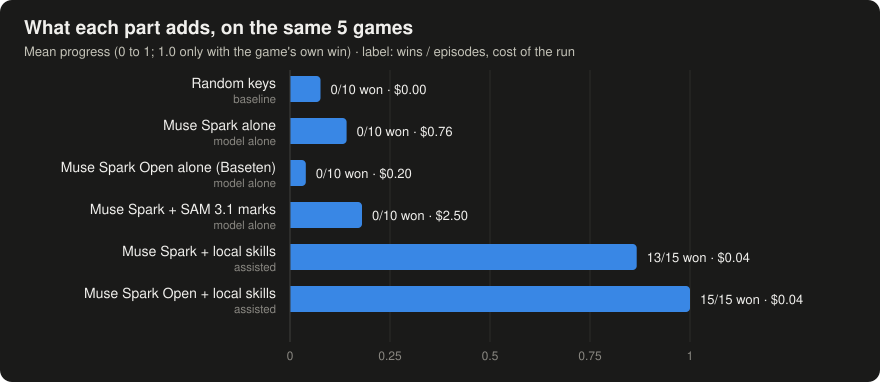

| | Result |
|---|---|
| Model alone, 14 games, 20-call cap (Muse Spark 1.3) | **0 of 28** wins; with SAM marks, more progress (0.217 against 0.185) |
| Model picks a skill (Muse Spark Open / Muse Spark 1.3) | **15 of 15** / **13 of 15** (the other 2 ended on a service error) |
| Co-op: asked-for parts done on 5 games, local skills (scripted requests such as "the next quarter of the game's progress"; no player involved) | **65 of 66**, 0 breaches |
| Co-op on the open-source 2048 (MIT), from pixels | **20 of 20** |
| Split controls: kept keys that reached a game | **0** |
| Live, a model choosing every key on the application's own requests | 4 of 10 parts done; every "done" it claimed was true (3 of 3) |
| SuperTuxKart 1.5, real game window, keyboard only | **1st place twice** on Novice; best 3rd on Intermediate |
| Breaches (a key off the card, or input while another window was in front) | **0** in all 8 result files that count them |

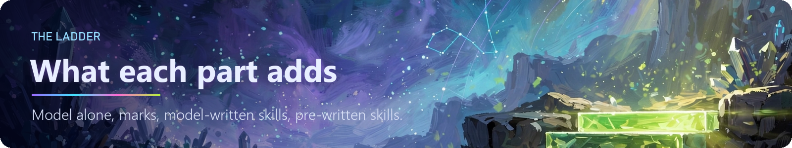

### The ladder

Each rung adds one piece on the same games: local floor (random and built-in), model alone, model with SAM marks, model-written
skills (SkillSmith), and model picking a pre-written skill. The full table, the SkillSmith games and the speed and cost per rung
are in [docs/metrics.md](docs/metrics.md#the-ladder).

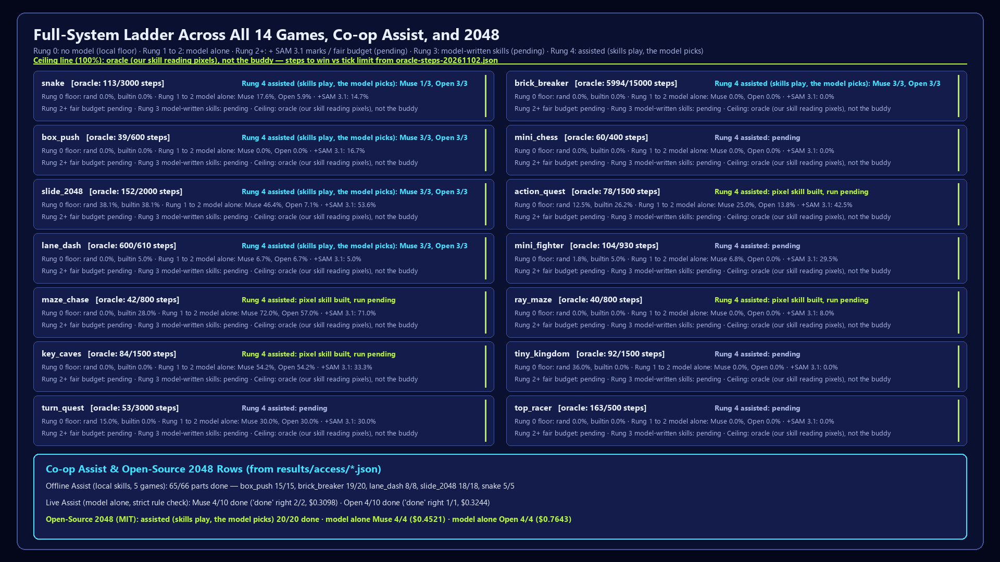

## Real games

**SuperTuxKart 1.5** (open source), in the real game window, keyboard only, offline. You install the game; nothing of it is
copied here. The pack reads the game's own files at run time (`input.xml` for the keys, `quads.xml` for the road), drives from the
minimap 20 times a second with no model in that loop, and lets Muse read the menus, the lessons and the results table while SAM names
items on the road ahead. It finished **1st twice on Novice** (Antediluvian Abyss, 3 laps, 4 karts).

```
python -m playfellow_coop stk --mission race --difficulty novice
python -m playfellow_coop stk widget        # the widget alone, docked on the game window
```

**Endless Sky 0.11.4** (open source, single-player): a pilot pack that reads the game's own `keys.txt` and plain-text save
(read-only), the HUD and radar from the screen, plans routes and fuel, takes fair bounties and fights by range rate. It never
changes a save, a data file or a plugin.

**Platformers and metroidvanias** (`playfellow_coop/games/platform`): a genre pack built from pixels and keys only: camera motion,
screen cuts and collectibles from the picture, a map built from where the buddy has been, boss cues learned across attempts, and a
runner for sprints, timed jumps, hovers and wall kicks. It is written for the genre, so a game brings only its controls card; its
first real game is next.

**Skill books.** Each pack keeps a catalogue of its game's and its genre's skills, each marked built, tested or known:
SuperTuxKart 89, Endless Sky 185, Rayman Legends 33 (researched from public sources, for the platformer pack), and 87 researched
platformer skills. They are in `playfellow_coop/games/*/SKILLS.md` and `research_skills.json`.

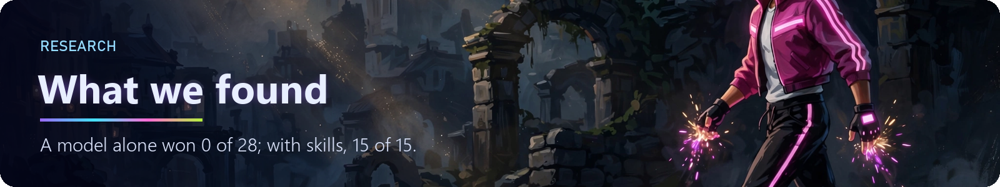

## Research

The question under the product: **can a model turn a spoken request and a marked picture into safe game keys, live?** What we found:

1. **Models plan; skills play.** Alone, at a fair call budget, both Muse models won 0 games: real-time games need hundreds to
   thousands of precise steps. Asked only to choose a local skill, the same models won 15 of 15 for a fraction of a cent a win.
   Perception helps progress (SAM marks lifted it from 0.185 to 0.217), but it does not replace control.
2. **Grounding beats raw pixels.** Numbered marks with stable ids (129 of 129 pairs) give the planner a vocabulary to point with,
   and a second look at the screen keeps "done" honest (every claimed "done" was true, 3 of 3).
3. **Models can write skills, safely.** SkillSmith's model-written skills pass a process sandbox and a held-out check before use,
   and reach progress 0.58 on a maze game and 0.6–0.65 on the open-source 2048; turning that progress into wins is the next step.
4. **Safety is structural.** The card filter, the focus check and the F12 path gave 0 breaches in every run that counts them,
   including runs where the model chose every key.
5. **Open weights are enough for the choosing.** On the skill games Muse Spark Open won 15 of 15 and 14 of 15 in two runs; Muse
   Spark 1.3 won 13 of 15 and 15 of 15. The choosing does not need the biggest model.

**The research kit, in this repo:** a Gymnasium-style gym over the arena games (`playfellow_coop/gym`), an evaluation kit with
isolation, attribution and receipts (`playfellow_coop/evalkit`), a training-data generator for "words plus marked picture to
keys" in English and Arabic that refuses any row made from a model's output (`train/`), Google ADK agents with ADK's own evaluator
(`playfellow_coop/adk_app`), and the three-part design (open model, open framework, private platform) with its loop and checks in
[docs/gegaa.md](docs/gegaa.md). The roadmap and how to join: [docs/research-roadmap.md](docs/research-roadmap.md). The proof
behind each accessibility promise: [docs/accessibility-proof.md](docs/accessibility-proof.md).

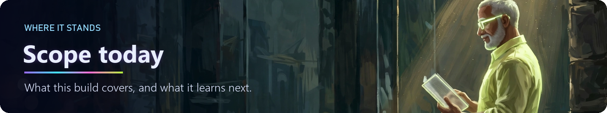

## Scope today

- **Games:** any Windows game window through the general card; fitted perception and skills for our Practice Arena, the open-source
  2048, SuperTuxKart (one track so far) and Endless Sky. Each new game is learned, not assumed.
- **Input:** keyboard on every game; mouse skills for the two arena mouse games win in the gym, and the live runner's mouse path is next.
- **Loop:** a single-rate see-think-act loop, with the precise work in local skills; the 60 Hz multi-rate loop belongs to the
  roadmap below.
- **People:** the next step is play sessions with disabled gamers, consenting adults, measured with them and in their own words.

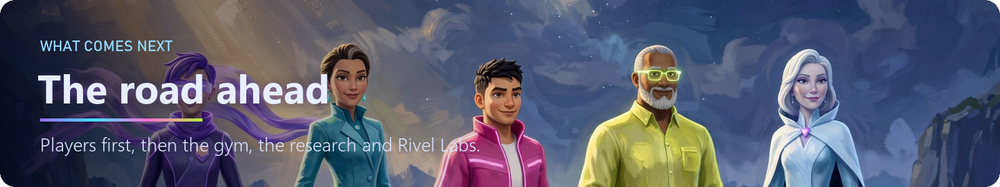

## What comes next

PlayFellow is the first product of **[Rivel Labs](https://rivel.pro)**. After the hackathon:

- **Players first: an accessibility programme.** Play sessions with disabled gamers, consenting adults; their minutes played past
  the point where their hands would have stopped, counted with them; an Arabic review of every phrase by native speakers.
- **Hardware and research budget.** A dedicated research machine for local models, faster perception (a light local detector
  for fast obstacles, with SAM for meaning), and the 60 Hz multi-rate loop.
- **Learning, in the open.** Reinforcement learning in the PlayFellow gym, supervised learning on the "words plus marks to keys"
  dataset, and unsupervised learning of game structure from play; every result published with its file.
- **More games, more skills.** The mouse path, more SuperTuxKart tracks and difficulties, the Endless Sky and platformer packs in
  live play, and every catalogue skill moved from known to tested to built.
- **The Rivel Labs platform.** [Playfellow](https://playfellow.rivel.pro) as a desktop app for Windows first, then other platforms
  where input rules allow; **Studio** for game creation, a **game and animation studio** for our own worlds and the Lightfolk crew,
  **World** for Rivel Labs' games, **Courses** on building game agents, and **Research** for open papers. Studio, World, Courses and
  Research are coming soon.
- **The long road.** Toward general, safe, embodied intelligence that plays with people, not instead of them: built in the open,
  with the player always holding F9 and F12.

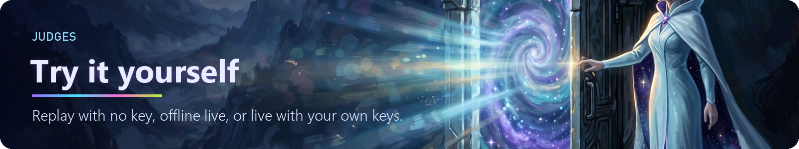

## Judges: try it

Judges: see the access note in the submission (how to reach the models we used). [JUDGES.md](JUDGES.md) starts with the one-line
setup, then five ways in, each with its commands and their real output: a replay with no key, the co-op with no key, live play with
your own key, testing it on a game of your own, and watching a model-written skill play.

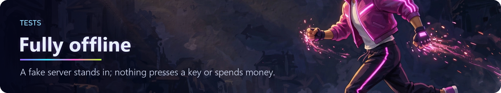

## Tests

```
.venv\Scripts\python -m pytest -q -W error
```

Every test runs offline: a fake server on 127.0.0.1 stands in for the Meta API, and nothing presses a key, grabs the screen, reads
a real key or spends money. Without the optional Rust DLL (`rust/README.md`) the tests that compare it with its Python twin are
skipped. The realtime voice socket is tested on websockets 16.1.1 and 17.3, so `pyproject.toml` allows `websockets>=16,<18`.

## What this does and does not do

It plays and talks with you. It does not judge or score the player. It plays offline, single-player games only, never against
other people online (`RESPONSIBLE_USE.md`). Security design and how to report a problem: [SECURITY.md](SECURITY.md).

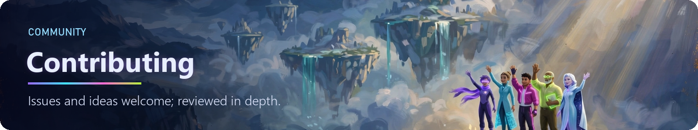

## Contributing

Issues and ideas are welcome, and every contribution is reviewed in depth: [CONTRIBUTING.md](CONTRIBUTING.md),
[SECURITY.md](SECURITY.md), [CODE_OF_CONDUCT.md](CODE_OF_CONDUCT.md). The hackathon asks that the submission be made by approved
participants during the event, so outside pull requests are merged after judging ends on 9 November 2026; open and discuss them
any time. The most valuable gift right now: a native Arabic speaker's review of our command phrases.

**Developer setup:** the one-line install above, then the tests (`.venv\Scripts\python -m pytest -q -W error`). Good places to
start: a controls card for a game you love (the engine's card format), a skill marked *known* in a pack's `SKILLS.md`, or the mouse
path for the live runner.

## Words used here

- **Controls card:** the list of keys the buddy may press in one game; every reply is checked against it before a key moves.
- **Breach:** a key off the card, or input while another window was in front. The count is 0 in every run that records it.
- **SAM marks:** numbered labels SAM 3.1 puts on the things in the picture, so the planner can say "go to 3".
- **Skill / pre-written skill:** local code that plays one kind of part precisely; a model picks it. **Model-written skill:** one the
  model wrote during the run (SkillSmith), used only after a sandbox and a held-out check.
- **Assisted / model alone:** a skill helped / the model chose every key. **Rung:** one step of the ladder of what each part adds.
- **IQM:** the interquartile mean, a progress average that ignores the best and worst quarter of runs.
- **MCP:** the Model Context Protocol, how agents such as Meta's Muse Code call tools.
- **Pack:** the code and skill book for one game or genre.

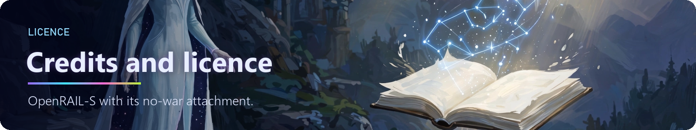

## Credits and licence

Built by Hesham Aboul-Fetouh ([@hesham88](https://github.com/hesham88)) with AI coding assistance, including Meta's Muse Code.
Licence: the `LICENSE` file is the engine's OpenRAIL-S licence with its no-war attachment, copied verbatim. Meta, Muse and SAM are
Meta's names, used here as plain text; this project is not affiliated with or endorsed by Meta. The research, tools and software we
use, with their licences, are listed in `NOTICE.md`.
