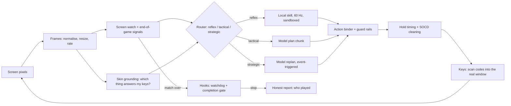

# GEGAA: Generalist Embodied Game-Agnostic Agents

GEGAA is the name for what this project is growing into: an agent that plays **any** game from the screen and the keyboard alone, with no game-specific hook, and says plainly who did the playing. It has three parts, and they are licensed and run differently on purpose.

| Part | What it is | Where it lives | Licence and terms |
|---|---|---|---|
| **Open Model** | The weights and training data recipe for a small model that turns "words plus a marked picture" into safe keys, and the benchmark that scores it | `train/`, `results/`, the dataset layout and the baseline (training itself is off until credits exist; no number is claimed until a results file written by the code exists) | The licence in [LICENSE](../LICENSE): open, with the non-violence terms. Training rows never come from another model's output |
| **Open Framework** | The harness around any model: universal interface, end-of-game detection, skin grounding, model-written skills in a sandbox, cost levers, honest evaluation, real-window input | This repository, `playfellow_coop/` | Same licence. Everything here is plain Python with numpy; no game hook, no engine access |
| **Private Platform** | Accounts, subscriptions, billing, the course, the hosted demo service, the desktop shell and its glass look | Not in this repository | Private. It uses the framework; the framework never depends on it |

The rule that keeps the split honest: the Open Framework runs and tests with nothing from the Private Platform, and a result is only called a result when a file written by the code backs it.

## The loop



Three loops run at three speeds: a reflex loop at frame rate that only local code may drive, a tactical loop a few times a second where the model hands over a short chunk of keys, and a strategic loop that runs only when something changes (a level starts, a skill fails, the match ends). The model is never in the frame loop.

## What each piece does and how it is checked

| Piece | Module | One-line idea | Check |
|---|---|---|---|
| Universal interface | `universal/` | Pixels in, tokens out: one action vocabulary, one clock, guard rails that drop anything off the card | `tests/test_universal.py` |
| End-of-game detection | `universal/eog.py` | Action contingency collapses, the HUD disappears or resets, the viewport freezes, a slow change-point test fires; a free probe verifies by pressing keys | `tests/test_eog.py` |
| Skin grounding | `universal/skin_grounding.py` | The avatar is the thing that answers keys; its colour and size are read, a skill's look is re-pointed at it | `tests/test_skin_grounding.py` |
| Grounding in moving worlds | `universal/flow_grounding.py` | When everything already moves, the avatar is the region whose **velocity changes** with a key, measured against the tick just before; teleports are handled as jumps | `tests/test_flow_grounding.py` |
| Hold timing | `universal/hold.py` | A tap shorter than a frame can be missed; holds are chosen from the poll rate | `tests/test_realtime.py` |
| Action chunks | `universal/chunks.py` | `<|action_start|>dx dy dz; K1..K6<|action_end|>` blocks, executed with keys that always come back up | `tests/test_realtime.py` |
| State-action cache and tiers | `universal/cache.py`, `universal/tiers.py` | Remember what worked in a near-identical picture; route each moment to the cheapest tier that can handle it | `tests/test_realtime.py` |
| Real-window input | `universal/winio.py`, `scan_backend.py` | Per-monitor DPI, focus that survives the foreground lock, scan codes, integrity level check | `tests/test_scan_backend.py` |
| Model-written skills | `skillsmith/` | A model writes a small class; three gates (static allow-list, isolated process, offline replay) decide whether it may play | `tests/test_skillsmith.py` |
| Skill sandbox | `skillsmith/ast_gate.py`, `_worker.py`, `osjail.py` | Layer 1: the static gate allow-lists module members. Layer 2: the worker only receives proxy namespaces, never a real module. Layer 3 (Windows): the worker runs at low integrity inside a job object that allows no second process | `tests/test_skillsmith.py` |
| Self-improvement | `skillsmith/loop.py`, `promote.py` | Propose, probe, compose on matched tasks; a promotion must beat the old harness on held-out episodes; the held-out set never reaches the proposer | `tests/test_selfimprove.py` |
| Beliefs and world model | `agent/` | Rules are hypotheses until tested, demoted when the game silently changes them; a model-written world model is checked against real transitions before it is used to look ahead | `tests/test_agent.py` |
| Loop hooks | `harness/hooks.py` | A watchdog (steps, seconds, dollars) and a completion gate that refuse to stop early; written as data, enforced in code | `tests/test_hooks_isolation.py` |
| Clean evaluation | `evalkit/isolation.py` | No network while a candidate is tried, a size limit on the always-on prompt, a ledger of what the whole search cost | `tests/test_hooks_isolation.py` |
| Gym | `gym/` | `reset` / `step` with a dense progress reward and a win that returns exactly 1.0; an oracle that must win every game before anything else is trusted | `tests/test_gym.py` |
| Honest evaluation | `evalkit/` | Who produced each key, interquartile mean with intervals, lifts, the cost of a win | `tests/test_evalkit.py` |
| Serving plan | `serve/`, `deploy/partner_gpu/` | The first action block is returned as soon as it is complete; routing never picks a model that trains on the data | `tests/test_serve.py` |

## The equations the code uses

Hold timing. A game polls the keyboard once per frame at a random phase. For an input held `h` ms and a frame of `f` ms:

```
P(seen by at least one poll)         = min(1, h / f)
P(held across two consecutive polls) = max(0, min(1, h / f - 1))
```

A 5 ms tap at 60 frames per second is lost two times in three; 35 to 50 ms registers every time.

Calls and cost per win. A failed episode still spends calls, so:

```
calls per win = calls per episode / win rate
cost per win  = cost per episode  / win rate
cost of a call = (prefix_tokens * r_prefix + dynamic_tokens * r_in + output_tokens * r_out) / 10^6
```

with `r_prefix` the cached input rate when the prefix cache is warm. The model predicts; a measured run replaces the prediction.

Normalised score and aggregate. With a random baseline `s_r` and a human baseline `s_h`:

```
normalised = (score - s_r) / (s_h - s_r)          0 is random, 1 is human level
IQM        = mean of the middle half of the runs
gap        = mean over runs of max(0, 1 - normalised)
Glass's delta = (mean_treated - mean_control) / std_control
```

Intervals come from a stratified bootstrap (runs are resampled inside each task).

Who played. For each input tick the origin is one of `human_skill`, `model_skill`, `model_chunk`, `fallback`. The label follows from the shares: any human-written help makes a row `[Assisted: Human Local Skill]`; model-written help only gives `[Autonomous: Model-Synthesized Skill]`; nothing local gives `[Model Alone]`.

Change of regime. A cheap embedding `e_t` of each picture is tracked with an exponential average `m_t = (1 - a) m_(t-1) + a e_t`; the cumulative sum `S_t = max(0, S_(t-1) + |e_t - m_t| - d)` fires when it crosses a threshold (`a = 0.03`, `d = 0.10` by default).

## What is not claimed

- The tests in this repository use a scripted brain or no model at all. A live result with a paid model counts only where a results file written by the code says so.
- The Open Model has a dataset generator and a baseline harness. It has not been trained, and no accuracy is claimed.
- The sandbox's low-integrity layer is a Windows feature; on other systems the two language layers are the whole barrier and the code reports `"none"` for the operating-system layer instead of pretending.
- Reading a world-readable file is not blocked by integrity levels. The scrubbed environment and the proxy namespaces are what keep secrets out of reach.
