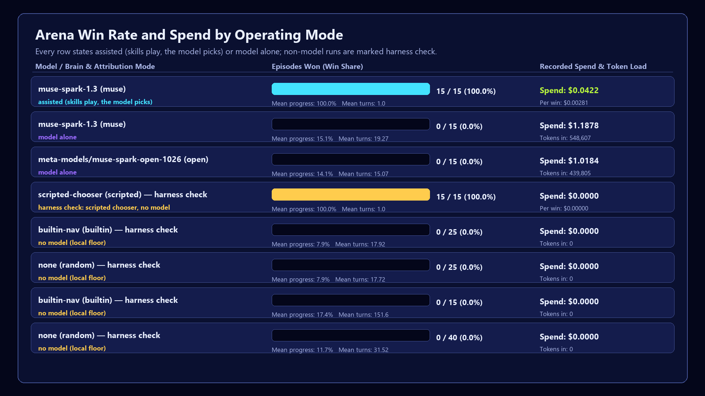
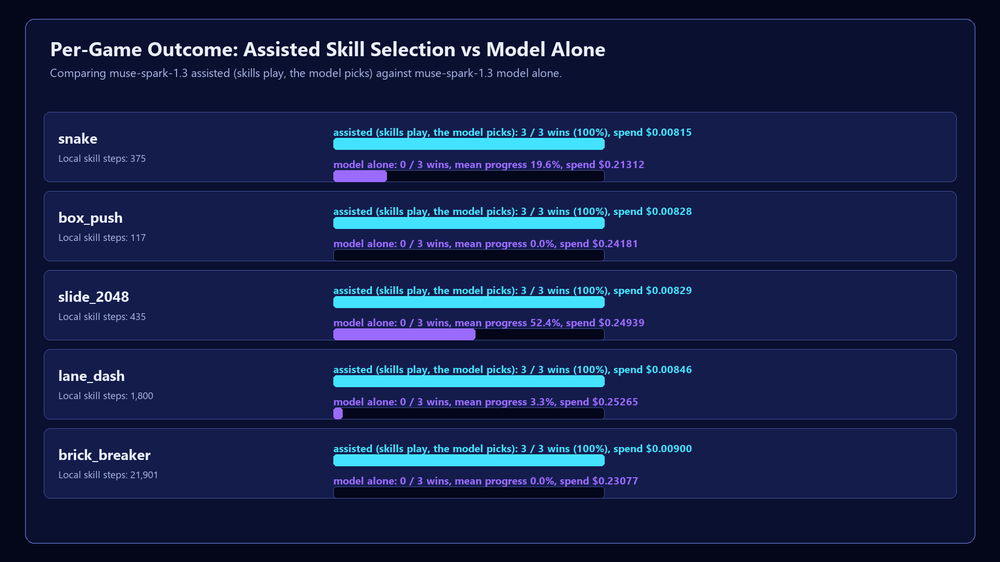
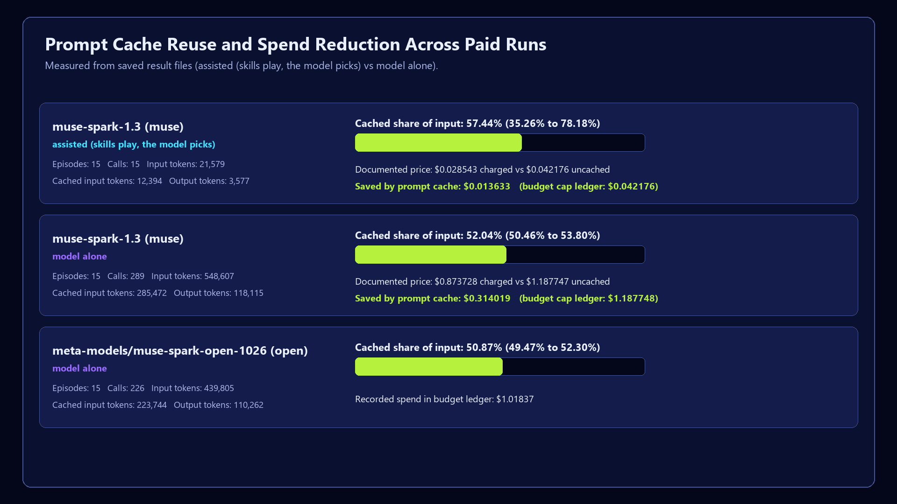
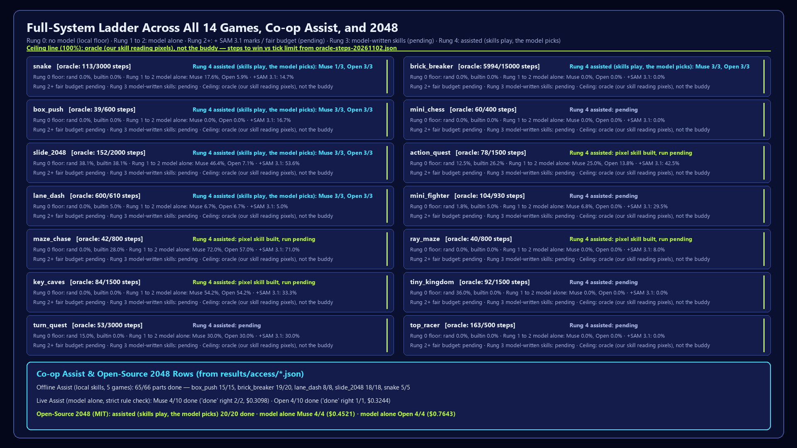
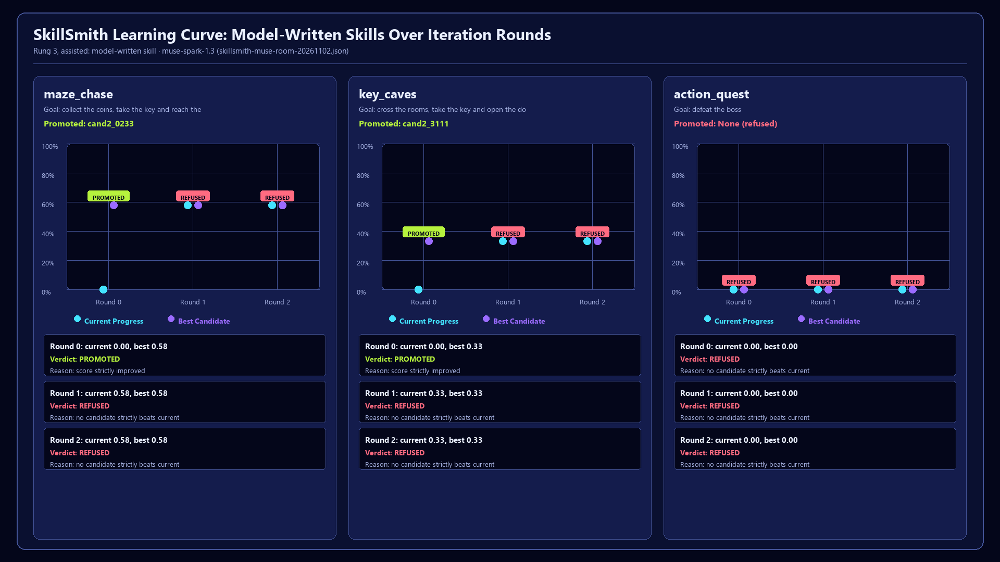

# Metrics: every measured number, with its result file

**Evidence rule.** Every number on this page and in the README comes from a JSON result file committed under `results/`, written by
the code that ran. Charts are drawn from those files by `tools/make_charts.py`; the speed and cost table by `bench/speed_cost_table.py`.
A result that was not run says so; a file that is not a result says so inside itself.

**Two words carry every row.** *Assisted* means local skills play and the model picks which one. *Model alone* means the model had
no skill to start. The two are never mixed in one number.

## The headline

| Row | Result | File |
|---|---|---|
| Assisted: Muse Spark Open picks a skill (2 Nov, the 14-game set's 5 skill games) | **15 of 15**, $0.03772 in all ($0.0025 a win) | `results/fifteen/open-skills-20261102.json` |
| Assisted: Muse Spark 1.3 picks a skill (2 Nov) | **13 of 15** (2 ended on a service error), $0.03564 | `results/fifteen/muse-skills-20261102.json` |
| Model alone + SAM 3.1 marks: Muse Spark 1.3 (2 Nov, 14 games, 20-call cap) | **0 of 28 wins**, mean progress 0.217 (model alone without marks: 0.185) | `results/fifteen/muse-sam-20261102.json`; `results/fifteen/muse-raw-20261102.json` |
| Assisted: Muse Spark 1.3 picks a skill | **15 of 15** = 5 games (snake, box_push, slide_2048, lane_dash, brick_breaker) x 3 seeds, $0.04075, 21,579 tokens in (13,787 cached) | `results/k-lane/muse-skills-pt1.json` |
| One-call probe | 1 of 1, $0.00282 | `results/k-lane/muse-probe.json` |
| Assisted: Muse Spark Open on Baseten picks a skill | **14 of 15**, $0.03576 | `results/k-lane/baseten-skills.json` |
| Model alone: Muse Spark 1.3, raw pixels, no skill | **0 of 15 wins**, mean progress 0.151, $1.18775 | `results/unseen/muse-raw-20261027.json` |
| Model alone: open weights, raw pixels | **0 of 15 wins**, mean progress 0.141, $1.01837 | `results/unseen/open-raw-20261027.json` |

`results/k-lane/muse-skills-pt1-billing-failed.json` is marked `"void"` inside itself (billing failed, no call reached the model). A
test keeps any paid row with episodes but zero tokens from standing without that mark, so no chart can read a billing failure as a score.

Muse Spark Open runs on Baseten; its dollar figures use Muse Spark's Standard price as an upper bound until Baseten's own price for
this model is published (`bench/open_weights_brain.py` says so in every file it writes).

## The co-op itself

| Measure | Result | File |
|---|---|---|
| Asked-for parts done, 5 arena games, local skills, $0 | **65 of 66**, 0 breaches | `results/access/access-20261102.json` |
| Split controls: kept-key presses that reached the game | **0** (every one refused by the guard), 0 breaches | `results/access/access-20261102.json` |
| Asked-for parts done on the open-source 2048 (MIT), from pixels | **20 of 20**, best tile 512 in all 5 runs | `results/access/osg-2048-20261102.json` |
| Live, a model choosing every key: parts really done (game progress) | 4 of 10 (Muse Spark 1.3), 4 of 10 (Muse Spark Open) | `results/access/assist-live-muse-strict-20261102.json`, `results/access/assist-live-open-strict-20261102.json` |
| Live: "done" claims that were true | 3 of 3 across both models (2 of 2 and 1 of 1) | `results/access/assist-live-muse-strict-20261102.json`, `results/access/assist-live-open-strict-20261102.json` |
| Voice commands understood (one adult speaker, 20 clips) | **15 of 20**: English 7 of 7, Egyptian Arabic 5 of 7, mixed 3 of 6; mean WER 0.23 | `results/voice/voice-20261102.json` |
| SAM 3.1 kept the same number on the same object | 129 of 129 frame pairs | `results/sam/sam-live-20261102.json` |
| Muse Wonder drafting the controls of unseen games | genre right 3 of 3, 68% of the real keys found; 10 of 10 debriefs with no invented number | `results/wonder/wonder-live-20261102.json` |

In the split-controls column the arena skills are not told about the split, so a refused key is simply a lost move: that column measures
safety (no kept key reaches the game), not parts done.

## The ladder

Each game group shows the same rungs. A row is filled only from a committed result file named in it.

The $0 harness check (a scripted chooser, no model) wins 36 of 42 episodes (12 of 14 games) with the 14 pixel skills
(`results/rung4/scripted-20261102.json`). Mini Chess and Tiny Kingdom are mouse games: their skills win in the gym, and the runner's
mouse path is the next piece of work.

A **pre-written skill** was written ahead of time by our team with AI coding agents, then reviewed and tested; the model at run time
only picks it. A **model-written skill** (rung 3) is written by the model during the run and must pass the sandbox and the held-out
check first. Older result files use an earlier label for it, explained in the README.

| Rung | Wins | Mean progress | File |
|---|---|---|---|
| 0 Local floor (random, 8 seeds a game) | 0 of 40 | 0.117 | `results/unseen/random-20261027.json` |
| 0 Local floor (built-in, no model) | 0 of 15 | 0.174 | `results/unseen/builtin-free-20261027.json` |
| 1–2 Model alone, Muse Spark 1.3 (20-call cap; a win needs 39–5,994 steps) | 0 of 15 | 0.151 | `results/unseen/muse-raw-20261027.json` |
| 1–2 Model alone, Muse Spark Open (same cap) | 0 of 15 | 0.141 | `results/unseen/open-raw-20261027.json` |
| 2+ Model alone + SAM 3.1 marks (20-call cap; 14 games) | 0 of 28 | 0.217 | `results/fifteen/muse-sam-20261102.json` |
| 3 Model-written skills (SkillSmith), Muse Spark 1.3 writes | 0 of 6 | 0.504 | `results/skillsmith/skillsmith-muse-room-20261102.json`, `results/skillsmith/skillsmith-muse-2048-20261103.json` |
| 3 Model-written skills (SkillSmith), Muse Spark Open writes | 0 of 6 | 0.521 | `results/skillsmith/skillsmith-open-20261102.json`, `results/skillsmith/skillsmith-open-2048-20261103.json` |
| 4 Model picks + pre-written skill, Muse Spark 1.3 | 15 of 15 | 1.0 | `results/k-lane/muse-skills-pt1.json` |
| 4 Model picks + pre-written skill, Muse Spark Open | 14 of 15 (snake 2 of 3) | 0.933 | `results/k-lane/baseten-skills.json` |

A rung 2+ run with a larger call budget and action chunks is the next run on the ladder; it has no file yet, so it has no row.

### SkillSmith: games with no pre-written skill

| Game | Rung 3 state | File |
|---|---|---|
| maze_chase | muse: promoted; held-out 0 of 2 wins, progress IQM 0.58, play $0; writing $0.146; open: promoted; held-out 0 of 2 wins, progress IQM 0.58, play $0; writing $0.136 | `results/skillsmith/skillsmith-muse-room-20261102.json`, `results/skillsmith/skillsmith-open-20261102.json` |
| key_caves | muse: promoted; held-out 0 of 2 wins, progress IQM 0.3333, play $0; writing $0.189; open: promoted; held-out 0 of 2 wins, progress IQM 0.3333, play $0; writing $0.196 | `results/skillsmith/skillsmith-muse-room-20261102.json`, `results/skillsmith/skillsmith-open-20261102.json` |
| action_quest | muse: no skill promoted (no candidate strictly beats the current skill on validation); writing $0.263; open: no skill promoted (no candidate strictly beats the current skill on validation); writing $0.280 | `results/skillsmith/skillsmith-muse-room-20261102.json`, `results/skillsmith/skillsmith-open-20261102.json` |
| osg_2048 | muse: promoted; held-out 0 of 2 wins, progress IQM 0.6, play $0; writing $0.042; open: promoted; held-out 0 of 2 wins, progress IQM 0.65, play $0; writing $0.040 | `results/skillsmith/skillsmith-muse-2048-20261103.json`, `results/skillsmith/skillsmith-open-2048-20261103.json` |

On the open-source 2048, progress counts tile doublings from the first board's 2 to the 2048 tile, so it is not a share of a win: the
model-written skills' best tiles on the 2 unseen boards were 256 and 64 (Muse) and 256 and 128 (open weights).

## Speed and cost

Stage times, dollars and tokens per win, cache share, and a local step against a model call, per rung:
`results/speed/speed-cost-20261102.json`, built only from the files above by `bench/speed_cost_table.py`. The Rust fast path's public
figure is 17–24x, the bracket of the measured medians in that table's source file.

## SuperTuxKart

Read off the game's own results screen (Antediluvian Abyss, 3 laps, 4 karts, 3 November): `results/stk/races.json`.

| Difficulty | Finish | Time | Winner's time |
|---|---|---|---|
| Novice | **1st, twice** | 5:49.238, then 4:29.365 | the same |
| Intermediate | 4th, 3rd, 3rd | 6:33.349, 3:40.215, 3:36.548 | 3:32.273 in the last race |

Skill status (built, tested, known) for the game and its genre: `playfellow_coop/games/stk/SKILLS.md` and
`results/stk/catalogue-intermediate.md`.
